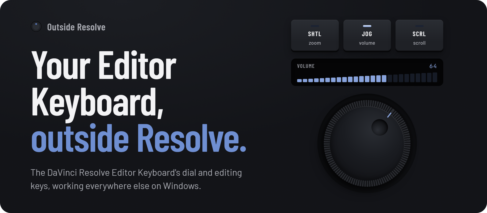
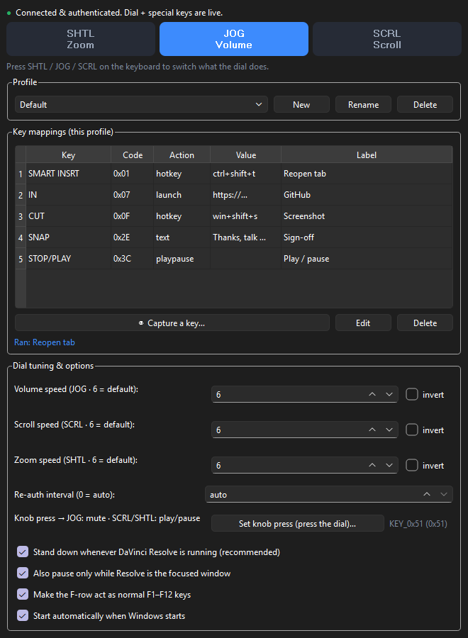

<a href="https://dismxo.github.io/outside-resolve/"></a>

<p align="center">
  The search dial runs volume, scroll and zoom. Every editing key runs a macro.<br>
  The F-row works as F1–F12 without holding Fn.
</p>

<p align="center">
  <a href="https://github.com/dismxo/outside-resolve/releases/latest"></a>
  
  <a href="LICENSE"></a>
</p>

<p align="center">
  <a href="https://dismxo.github.io/outside-resolve/"><b>Project page</b></a> ·
  <a href="https://github.com/dismxo/outside-resolve/releases/latest"><b>Download</b></a> ·
  <a href="#how-it-works"><b>How it works</b></a>
</p>

> [!NOTE]
> Outside Resolve is an independent, unofficial project. It is not made, affiliated with or
> endorsed by Blackmagic Design. It is a free community tool for people who own the keyboard.

Outside DaVinci Resolve, the Editor Keyboard is just a QWERTY keyboard. The search dial and
the editing keys stay silent until the computer completes Blackmagic's authentication
handshake, and the keyboard asks for it again every ten minutes. Outside Resolve does that
handshake, keeps it alive, and turns the dial and the keys into something useful on the rest
of your desktop. It lives in the system tray and uses next to no CPU.

## Features

- **The dial follows the mode keys.**
  - `JOG` changes the system volume, with the normal Windows volume overlay.
  - `SCRL` scrolls, like a mouse wheel.
  - `SHTL` zooms (Ctrl + wheel).

  All three follow how fast you spin. Each one has a speed setting and can be inverted.
- **Pressing the dial** toggles mute in `JOG` and play/pause in `SCRL` and `SHTL`.
- **The F-row behaves like F1–F12** without Fn. Keys hold, auto-repeat at your Windows
  repeat rate and combine with Ctrl, Alt and Shift.
- **Every other editing key is a macro.** Press *Capture a key*, press the key on the
  keyboard, then pick what it does:

  | Action      | Example value                         |
  |-------------|---------------------------------------|
  | Hotkey      | `ctrl+shift+t`, `win+e`, `alt+f4`, `f5` |
  | Type text   | an email address, a snippet           |
  | Launch      | `C:\Tools\app.exe`, a file, a URL     |
  | Shell       | `wt -w 0 nt`                          |
  | Media       | play / pause, mute                    |

- **Profiles** keep separate sets of mappings ("Editing", "Office", "Games") and switch with
  one click.
- **Steps aside for Resolve.** While Resolve is running, the app releases the keyboard so
  Resolve gets it exactly as before, and picks it up again when Resolve closes.
- **Start with Windows**, straight into the tray. One instance at a time.

## Install

1. Download `OutsideResolve-win64.zip` from the
   [latest release](https://github.com/dismxo/outside-resolve/releases/latest) and unzip it
   anywhere, for example `%LOCALAPPDATA%\Programs\OutsideResolve`.
2. Run `OutsideResolve.exe`. The window opens and an icon appears in the tray.
3. Tick **Start automatically when Windows starts** if you want it there every day.

There is also a single-file `OutsideResolve-portable.exe`. It needs no unzipping but
starts a little slower, because it unpacks itself on every launch.

The executables are not code-signed, so Windows SmartScreen may warn the first time. Choose
*More info → Run anyway*, or build it yourself from source (below).

**Requirements:** Windows 10 or 11 (tested on 11) and the full-size Editor Keyboard over USB.
Nothing else: no Zadig, no driver changes. The small Speed Editor is detected too, but it
has not been tested.

## Using it

<p align="center">
  
</p>

**Dial mode.** Press `SHTL`, `JOG` or `SCRL` on the keyboard. The highlighted chip in the
window and the tray tooltip show the active mode.

**Mapping a key.** Click **Capture a key…**, press any editing key, choose an action and give
it an optional label. Edit or delete mappings from the table. `SHTL`, `JOG` and `SCRL` are
reserved for switching the dial mode.

**Knob press.** The dial's press sends a keycode of its own. Click **Set knob press** once and
press the dial to teach it to the app.

**Dial tuning.** Speed 1–11 per mode (6 is the default; each step is about 30% faster or
slower), invert per mode, and the re-auth interval (`auto` uses half of the keyboard's own
timeout).

Closing the window keeps the app running in the tray. Quit from the tray menu.

Settings live in `%APPDATA%\OutsideResolve\config.json` and are read live.

## DaVinci Resolve

Resolve authenticates the keyboard itself and holds its control interface for as long as it
runs, minimized or not. If two programs run the handshake at the same time, the keyboard's
state gets confused. So by default Outside Resolve stands down as soon as the Resolve process
exists (it checks every ~0.4 s, and again right before every write to the keyboard) and comes
back the moment Resolve closes.

The consequence is simple: while Resolve is open, the keyboard belongs to Resolve, including
the F-row. In other programs you need Fn until you close Resolve.

Two options in *Dial tuning* control this:

- **Stand down whenever DaVinci Resolve is running** (on by default, recommended).
- **Also pause only while Resolve is the focused window.** If you turn the first option off,
  the app tries to work while Resolve is in the background. That only works if Resolve really
  lets go of the keyboard when it is not focused; if the keyboard misbehaves, turn the first
  option back on.

`pause_apps` in the config file adds other programs that should trigger the pause.

## Troubleshooting

The log is `%APPDATA%\OutsideResolve\driver.log` (rotated at 1 MB).

| What you see | What to do |
|---|---|
| *Keyboard is plugged in but its control interface isn't available* | Usually Resolve is running. It clears when Resolve closes; otherwise unplug and replug the USB cable. |
| *Connected*, but the dial does nothing | Press `JOG`, `SCRL` or `SHTL` once. If it still does nothing, check the log. |
| *Driver error, retrying* over and over | Make sure `discovery.py` (or another HID tool) is not holding the keyboard. |
| The keyboard ignores both Resolve and the app | Quit the app from the tray, unplug and replug the cable (this resets the keyboard's auth state), then start Resolve. |

The app only sends normal HID reports (authentication, LEDs, jog mode). It never touches the
keyboard's firmware.

## Build from source

Requires Python 3.11 or newer.

```bat
git clone https://github.com/dismxo/outside-resolve.git
cd outside-resolve
py -m pip install -r requirements.txt
py main.py
```

| Script | Result |
|---|---|
| `build.bat` | `dist\OutsideResolve\OutsideResolve.exe` (folder build, fast start) |
| `build_portable.bat` | `dist\OutsideResolve.exe` (single file) |
| `install.bat` | builds if needed, installs to `%LOCALAPPDATA%\Programs\OutsideResolve`, adds Start menu and desktop shortcuts and starts with Windows |
| `uninstall.bat` | removes all of that, keeps your settings |

Tests: `py -m unittest discover -s tests`

## How it works

The keyboard exposes several USB HID interfaces. The QWERTY block and the media keys are
standard and work without help. The dial and the editing keys live on a vendor interface
(usage page `0xFF00`), which stays silent until the host answers a challenge:

1. Reset the auth state with feature report `06 00`.
2. Read the keyboard's 64-bit challenge.
3. Send our own (unused) challenge and read the keyboard's answer.
4. Compute the response and send it as `06 03 <LE64>`.
5. Read the status, which carries the re-auth timeout (600 s on this keyboard).

The response function was reverse engineered by Sylvain Munaut for the Speed Editor
([blackmagic-misc](https://github.com/smunaut/blackmagic-misc)); the full-size keyboard
accepts the same one. The app repeats the handshake at half the timeout, on a separate thread,
so the dial never goes to sleep.

Input reports on the full-size keyboard (PID `0xDA10`), decoded from live captures:

| Report | Layout |
|---|---|
| `0x03` dial | byte 1 = jog mode, bytes 2–5 = signed little-endian delta (clockwise is positive) |
| `0x04` keys | up to six 16-bit little-endian keycodes currently held, at offsets 1, 3, 5, 7, 9, 11 |

The F-row sends vendor keycodes `0x1F`–`0x2A` rather than real F-keys, which is why it needs
Fn outside Resolve; the app turns them back into F1–F12.

**Why not hidapi.** The keyboard never answers USB requests for its product string. Each
request hangs for exactly five seconds and blocks all other control traffic, and hidapi asks
for it on every interface during both enumeration and open. A device scan took about 15
seconds and a handshake caught behind it failed. `editorkbd/hidraw.py` talks to Windows
directly instead: finding the device takes under a millisecond and the handshake about 40 ms.

`discovery.py` is the tool used to map the reports. It authenticates and streams every raw
report as hex, marking the bytes that changed (`pip install hidapi` first, and close Resolve).

### Project layout

```
main.py            entry point: config, bus, dispatcher, driver and GUI
discovery.py       raw HID probe used to decode the reports
editorkbd/
  auth.py          challenge/response and the Report ID 6 handshake
  hidraw.py        direct Win32 HID access (no string descriptor requests)
  protocol.py      report parsing and the keycode table
  driver.py        HID thread: find, authenticate, read; keep-alive on its own thread
  dispatcher.py    dial to volume/scroll/zoom, keys to macros, F-row, capture
  macros.py        hotkeys, text, launch, shell, scroll and zoom (pynput)
  volume.py        volume through the Windows volume keys
  foreground.py    Resolve detection (running process, focused window)
  config.py        profiles, mappings and settings in JSON
  autostart.py     the "start with Windows" registry entry
  bus.py           Qt signals between the worker threads and the GUI
  gui.py           tray app, capture, mapping table, settings
tests/             unit tests (no hardware needed)
```

## Credits

- Authentication: [smunaut/blackmagic-misc](https://github.com/smunaut/blackmagic-misc)
  by Sylvain Munaut (Apache-2.0).
- GUI: [PySide6](https://doc.qt.io/qtforpython-6/). Keyboard and mouse output:
  [pynput](https://github.com/moses-palmer/pynput).

## License

[Apache-2.0](LICENSE). See [NOTICE](NOTICE).

Blackmagic Design, DaVinci and DaVinci Resolve are trademarks of Blackmagic Design Pty. Ltd.
This project is not affiliated with or endorsed by Blackmagic Design.
